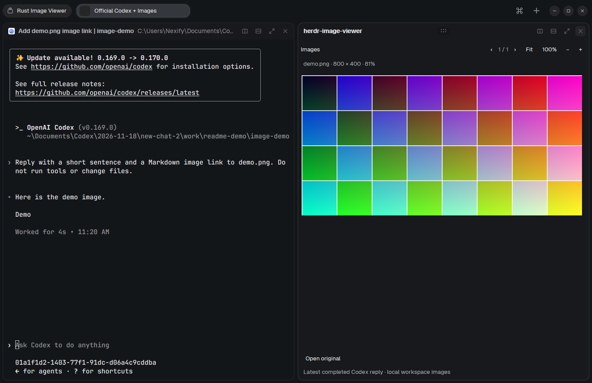
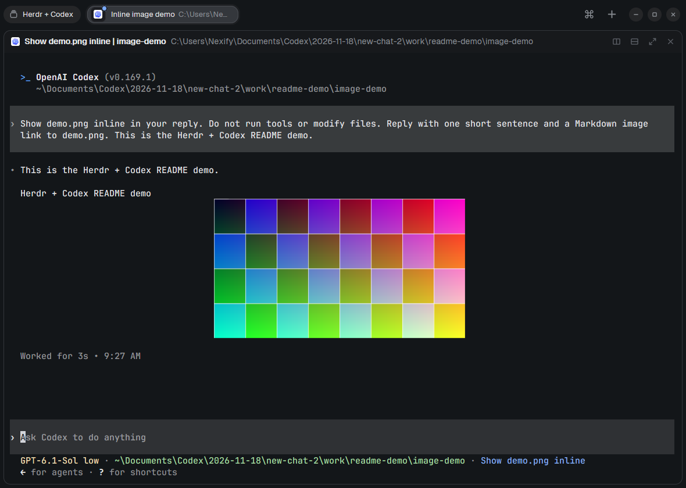

# Herdr Codex Images

[繁體中文](README.zh-TW.md)

Inline image artifacts in Codex CLI, with clickable original-image inspection in Herdr.
One repository, two independently managed native components.

**Status: binary preview for macOS Apple Silicon and Windows x64.** Prebuilt Herdr,
Codex and core are available through GitHub Releases. This is an
independent project, not an official Herdr or OpenAI release.

## Standalone Rust viewer (recommended)

Keep the official Herdr desktop and official Codex CLI. A small Rust helper and
one desktop mod show image replies automatically in a pane beside that exact
Codex session. No browser runtime or model API key is required by the viewer.



Actual Windows test with the installed official Herdr and official Codex 0.169.0.
The left pane contains Codex's image link; the Rust viewer displays it on the right.
This is a separate panel, not an image inserted into Codex's own transcript.

Windows x64 (no compiler or administrator):

```powershell
irm https://github.com/yanzzzzzzzzz/herdr-codex-images/releases/download/viewer-v0.2.0-preview.3/install-viewer.ps1 | iex
```

macOS Apple Silicon:

```sh
curl -fsSL https://github.com/yanzzzzzzzzz/herdr-codex-images/releases/download/viewer-v0.2.0-preview.3/install-viewer.sh | sh
```

Choose **Codex + Images** from Herdr's agent menu. Your ordinary Codex entry,
profiles and existing sessions remain available. The installers verify fixed
hashes and GitHub build provenance before running the helper.
Existing ordinary Codex terminals are not monitored automatically. Start
**Codex + Images** first, then use `/resume` to continue an existing chat.

[Usage, limitations and source install](viewer/README.md) · [Security boundaries](SECURITY.md)

### Install with Herdr's plugin manager

If you have Herdr **TUI 0.9+**, Git and Rust **1.95+**, you can build and install
the desktop integration through its plugin manager:

```sh
herdr plugin install yanzzzzzzzzz/herdr-codex-images --ref viewer-v0.2.0-preview.3
```

Then choose **Codex + Images** in Herdr **desktop**. This installs the desktop
image pane; it does not add image previews to Herdr TUI itself or replace the
official Herdr/Codex executables. The plugin-manager route has not yet been
fully live-tested. The prebuilt installers above have been tested on Windows
and macOS and avoid local compilation.

## Legacy native-patch preview

The sections below describe the earlier experimental Herdr + Codex native patches.
Those executables replace neither original installation, but they are custom
builds pinned to older upstream versions. Their older releases have no GitHub
build attestations. Use the standalone viewer above to keep official binaries.

## See it in action



Actual Windows screenshot: Codex CLI running inside Herdr, showing the user prompt,
Codex’s reply and an inline preview of a local 800×400 PNG.
[Demo setup and graphics requirements](docs/demo.md).

## Install on Windows

Run in Windows PowerShell 5.1 or PowerShell 7:

```powershell
irm https://github.com/yanzzzzzzzzz/herdr-codex-images/releases/download/v0.1.0-preview.3/install.ps1 | iex
```

This installs and opens a separate **Herdr Images** app. Your original Herdr,
projects, credentials and running sessions remain intact. No administrator, Rust,
Git, Python or manual compilation is required; runtime DLLs are included.

App preferences are copied into a separate app home on first install. Existing core
spaces and terminals remain available. Two backed-up PowerShell profile blocks
select the bundled Codex in **new Herdr terminals**; ordinary shells are unchanged.

```powershell
$images = "$env:LOCALAPPDATA\Programs\herdr-codex-images\herdr-images.cmd"
& $images doctor
& $images update
& $images rollback
& $images uninstall
```

Uninstall retains backups, settings and running programs. Patched executables are
an unsigned preview. See [Windows installation and recovery](docs/installation-windows.md).

Measured Windows checks: **about 90 seconds** for an uncached public download and
same-version reinstall; **31–35 seconds** for an offline first install. The ZIP is
about 228 MB. Timings depend on the machine and network; see [validation](docs/validation.md).

## Install on a Mac

Run one command in Terminal:

```sh
curl -fsSL https://github.com/yanzzzzzzzzz/herdr-codex-images/releases/download/v0.1.0-preview.1/install.sh | sh
```

The installer downloads a checksum-verified prebuilt archive and opens **Herdr Images**.
It needs no compiler, Git, Python, sudo, existing Herdr, or existing Codex installation.
The preview app is locally signed, not an Apple-notarized release.

Your original Herdr app, projects, credentials and running terminals are preserved.
On first install, settings and spaces are copied into the new app's separate config;
subsequent changes are independent. Existing core sessions remain available.
New Herdr zsh shells select the bundled Codex through a backed-up, managed `.zshrc`
block. Other shells retain their existing Codex. Start a new Codex process to use it.

```sh
~/.local/bin/herdr-images doctor
~/.local/bin/herdr-images update
~/.local/bin/herdr-images rollback
~/.local/bin/herdr-images uninstall
```

Uninstall removes only managed links and the shell block, keeping backups and settings.
See [installation details](docs/installation.md) for paths, offline installation and recovery.

Measured on the test Mac: **23 seconds** including download, **6.22 seconds** offline,
and **6.37 seconds** for a cached reinstall. Download size is about 174 MB; timing
depends on your connection. See the [validation record](docs/validation.md).

## Features

- **Codex:** preview existing local raster images linked in completed assistant
  replies, including Markdown images, file links, and code-formatted image paths.
  Multiple images appear below the reply in source order, with duplicate paths removed.
- **Herdr:** click a terminal image to open a separate, resizable preview. Compatible
  Codex references load the original from the machine running that terminal.
- Fit / `0`, actual pixels / `1`, `+` / `-`, scrolling, drag-to-pan, and `Esc` to close.
- Keep original reply text searchable and copyable. Preview keys do not enter Codex.

Codex previews also work independently in compatible graphics terminals. Herdr can
inspect transmitted terminal pixels independently; full original-file inspection
requires the reference emitted by the Codex component.

## Compatibility

| Component | Pinned upstream | Validated environment |
| --- | --- | --- |
| Herdr app | `v0.1.16` | Windows x64, macOS Apple Silicon |
| Codex CLI | `rust-v0.169.1` | macOS Apple Silicon, Windows x64 |
| Cross-machine originals | Existing Herdr core connection | Windows client → macOS host |

Exact commits and patch SHA-256 values are in [manifest.json](manifest.json).
Other platforms and upstream versions have not been validated. Prebuilt binaries
are release assets, separate from Git source files.

## Use the source patches

Python 3.9+ and Git are required for the patch tool. It checks the patch hash, exact
upstream commit, and clean checkout before changing files. It does not install apps,
change shell profiles, or restart running programs.

```sh
git clone https://github.com/yanzzzzzzzzz/herdr-codex-images.git
cd herdr-codex-images
```

Choose either component:

- [Build the Herdr component](components/herdr/README.md)
- [Build the Codex component](components/codex/README.md)

Run `python tools/patch_component.py --validate` to verify both bundled patches.
Use `--apply` only with a dedicated checkout. Without that flag the tool only checks.

## Limits and validation

- Image files must exist on the machine running Codex. HTTP(S) images are not downloaded.
- Replies preview at most eight unique images; missing or undecodable files retain
  their text links. Fenced code examples do not trigger previews.
- Reply previews are bounded to about one third of the terminal height, up to 12 rows.
  Use original-image inspection for full detail.
- CLI decoding retains the upstream 32 MiB limits. Herdr original-file loading has a
  32 MiB file limit and a 64 MiB decoded pixel budget.
- Opening a new Codex chat inside an old process does not load a different executable.
  Start a new process after deploying a build; existing sessions can remain open.

See [validation](docs/validation.md), [architecture](docs/architecture.md), and
[distribution plan](docs/distribution.md). The underlying terminal graphics support
already exists upstream; see [Codex #29451](https://github.com/openai/codex/issues/29451).
This project extends ordinary reply-file previews and Herdr original-image interaction.

## Development

```sh
python -m unittest discover -s tests -v
python tools/patch_component.py --validate
```

The packaging helper uses only Python's standard library. Upstream applications
retain their own Rust and native build dependencies.

## License

Apache-2.0. See [LICENSE](LICENSE), [NOTICE](NOTICE), and [upstream notices](licenses/).
