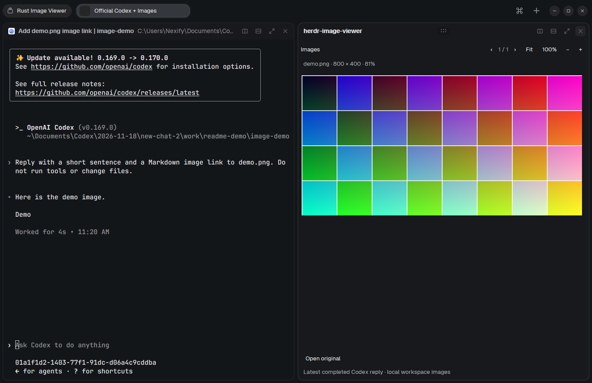
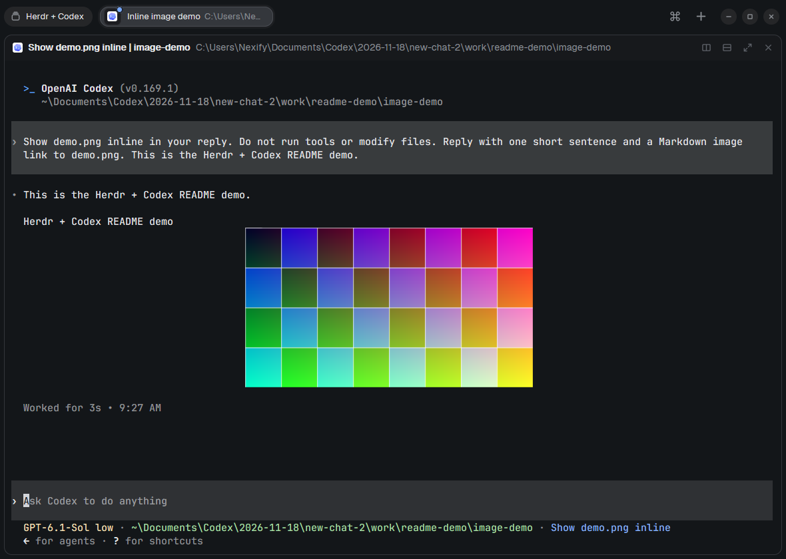

# Herdr Codex Images

[English](README.md)

在 Codex CLI 回覆中直接預覽圖片，並在 Herdr 點擊終端圖片查看清晰原圖。
同一個專案維護 Herdr、Codex 兩個可分別使用的原生元件。

**目前提供 Mac Apple Silicon 與 Windows x64 預編譯預覽版。**
這是獨立整合專案，並非 Herdr 或 OpenAI 官方版本。

## 獨立 Rust 圖片工具（建議）

沿用官方 Herdr 桌面版與官方 Codex CLI，由獨立 Rust 工具和一個桌面 mod，
把該 Codex 工作階段的圖片回覆自動顯示在旁邊。Viewer 不需要瀏覽器或模型 API key。



Windows 實測：左側是官方 Codex 0.169.0 的圖片連結，右側由 Rust 工具顯示圖片。
這是獨立預覽面板，圖片不會插入官方 Codex 自己的對話排版。

Windows x64，不需要編譯器或管理員：

```powershell
irm https://github.com/yanzzzzzzzzz/herdr-codex-images/releases/download/viewer-v0.2.0-preview.2/install-viewer.ps1 | iex
```

macOS Apple Silicon：

```sh
curl -fsSL https://github.com/yanzzzzzzzzz/herdr-codex-images/releases/download/viewer-v0.2.0-preview.2/install-viewer.sh | sh
```

安裝後從 Herdr 的 agent 選單選 **Codex + Images**。原本 Codex 入口、設定檔與工作階段保留。
安裝器會先驗證固定雜湊及 GitHub 建置來源，才執行工具。

[使用方式、限制與原始碼安裝](viewer/README.md) · [安全界線](SECURITY.md)

## 舊版原生修補預覽

以下是先前修改 Herdr 與 Codex 原生程式的實驗版本。它們採獨立安裝、保留原版，
但仍是固定舊版上游的自訂執行檔，舊發布也沒有 GitHub 建置來源證明。
若要沿用官方執行檔，請使用上方的獨立 Rust 版。

## 實際展示



Windows 實際截圖：在 Herdr 裡開啟 Codex CLI，畫面同時顯示使用者提問、Codex 回覆，
以及回覆下方的本機 800×400 PNG 圖片預覽。
[展示重現方式與圖形模式需求](docs/demo.md)。

## Windows 一個指令安裝

在 Windows PowerShell 5.1 或 PowerShell 7 執行：

```powershell
irm https://github.com/yanzzzzzzzzz/herdr-codex-images/releases/download/v0.1.0-preview.3/install.ps1 | iex
```

安裝後自動開啟獨立的 **Herdr Images**。原 Herdr、專案、登入資料及執行中的工作階段都保留，
不需要管理員、Rust、Git、Python 或自行編譯，所需執行階段 DLL 已包含在套件中。

首次複製 App 設定到獨立目錄，沿用既有 core 的空間與終端。安裝器備份兩種 PowerShell
的設定檔，只加入一段可移除設定，讓**新的 Herdr 終端**使用圖片版 Codex；一般終端不變。

```powershell
$images = "$env:LOCALAPPDATA\Programs\herdr-codex-images\herdr-images.cmd"
& $images doctor
& $images update
& $images rollback
& $images uninstall
```

解除安裝保留備份、設定與執行中的程式。此為尚未簽章的預覽版。
詳細路徑與還原方式見 [Windows 安裝說明](docs/installation-windows.md)。

Windows 實測：首次從公開網址下載並重裝約 **90 秒**；離線首次安裝約 **31–35 秒**。
套件約 228 MB，時間依電腦與網路而異，詳見[驗證紀錄](docs/validation.md)。

## Mac 一個指令安裝

在終端執行：

```sh
curl -fsSL https://github.com/yanzzzzzzzzz/herdr-codex-images/releases/download/v0.1.0-preview.1/install.sh | sh
```

安裝器驗證下載雜湊後，自動開啟 **Herdr Images**。不需要編譯器、Git、Python、sudo，
也不要求先安裝 Herdr 或 Codex。預覽版採本機簽章，尚非 Apple 公證版本。

原本的 Herdr、專案、登入資料與執行中的終端均保留。首次將設定與空間複製到獨立設定目錄，
之後兩個 App 各自保存設定；既有 core 工作階段仍可使用。安裝器備份 `.zshrc`，
只加入一段可移除的設定，讓新的 Herdr 終端使用圖片版 Codex；一般終端維持原本版本。
既有 Codex 程序需重新啟動才會使用新執行檔。

```sh
~/.local/bin/herdr-images doctor     # 檢查安裝
~/.local/bin/herdr-images update     # 更新
~/.local/bin/herdr-images rollback   # 還原上一版
~/.local/bin/herdr-images uninstall  # 解除整合，保留備份與設定
```

詳細路徑、離線安裝與還原方式見 [安裝說明](docs/installation.md)。

測試 Mac 的實測：**含下載 23 秒**、離線安裝 **6.22 秒**、有快取重裝 **6.37 秒**。
下載約 174 MB；實際耗時依網路而異。詳見 [驗證紀錄](docs/validation.md)。

## 功能

- Codex 回覆完成後，直接顯示本機圖片連結、Markdown 圖片及反引號中的圖片路徑。
- 多張圖片依序顯示，相同檔案去重；保留原本說明、搜尋與複製內容。
- 在 Herdr 點擊圖片開啟預覽，透過既有連線從終端所在機器讀取原圖。
- 支援 Fit／`0`、100%／`1`、`+`／`-`、捲動、拖曳及 `Esc` 關閉。

Codex 元件可在支援圖片協定的其他終端獨立使用。Herdr 元件可獨立查看終端傳入的
圖片像素；讀取完整原檔則需要 Codex 元件提供的原圖參照。

## 已驗證組合

| 元件 | 上游版本 | 測試環境 |
| --- | --- | --- |
| Herdr app | v0.1.16 | Windows x64、macOS Apple Silicon |
| Codex CLI | rust-v0.169.1 | macOS Apple Silicon、Windows x64 |
| 遠端原圖 | 既有 Herdr core 連線 | Windows 用戶端 → macOS 主機 |

精確 commit 與修補檔 SHA-256 見 [manifest.json](manifest.json)。其他平台及版本尚未驗證。

## 使用原始碼

先取得本專案，再依元件說明複製指定版本的上游原始碼：

```sh
git clone https://github.com/yanzzzzzzzzz/herdr-codex-images.git
cd herdr-codex-images
```

- [Herdr 建置方式](components/herdr/README.md)
- [Codex 建置方式](components/codex/README.md)

工具需要 Python 3.9+ 及 Git。`python tools/patch_component.py --validate` 可驗證兩份
修補檔；套用時會檢查 SHA-256、上游 commit 與工作目錄是否乾淨。
工具只修改指定的原始碼 checkout，不安裝程式、不修改 shell 設定，也不重啟現有工作階段。

## 限制與驗證

圖片必須存在於 Codex 所在機器；不自動下載 HTTP(S) 圖片。每則回覆最多預覽 8 張
不同圖片，程式碼區塊中的範例不觸發預覽。回覆預覽高度約為終端三分之一，上限 12 列。
遺失或無法解碼的檔案保留文字連結。

CLI 沿用上游 32 MiB 限制；Herdr 原圖讀取的檔案上限為 32 MiB、解碼像素預算 64 MiB。
部署後需啟動新的 Codex 程序；舊程序中的 `/new` 不會更換執行檔。

測試範圍見 [驗證紀錄](docs/validation.md)，設計見 [架構](docs/architecture.md)。
終端圖片繪製能力已有上游實作；本專案延伸一般回覆的圖片檔案預覽與 Herdr 原圖互動。

## 後續發布

目前 GitHub Releases 提供 Mac、Windows 原生套件與雜湊，安裝指令負責下載、驗證及可還原的啟用。
plugin marketplace 入口尚待完成。詳細範圍見 [發布規劃](docs/distribution.md)。

Apache-2.0；上游授權與聲明收錄於 [licenses](licenses/)。
