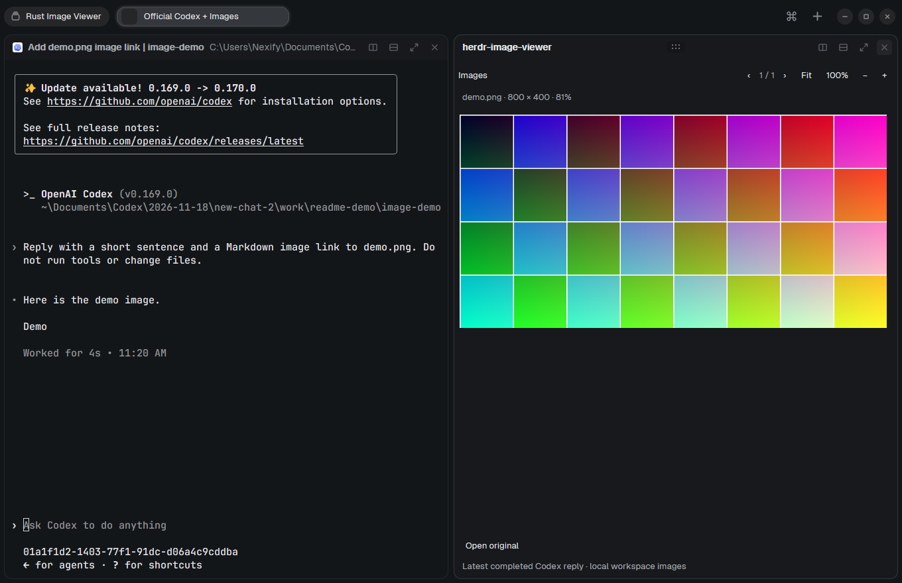

# Standalone Rust image viewer

One local Rust helper and one Herdr desktop mod. Keep the official Herdr desktop
and official Codex CLI. Choose **Codex + Images** from Herdr's agent menu: image
links in a completed reply appear automatically in the pane beside that session.
The viewer does not insert images into Codex's own terminal transcript.



## Install

Use the fixed-version installers in the repository README. They download an
exact GitHub CLI verifier archive pinned by SHA-256, verify the viewer's hash,
immutable release, workflow, tag, source commit and repository ID, then execute
the verified helper. No administrator, compiler, browser or global PATH edit is
needed. Herdr desktop and Codex must already be installed.

From reviewed source, with Rust 1.95+:

```sh
cargo install --path viewer --locked
herdr-image-viewer install-desktop
```

The Herdr **TUI** plugin manager is an optional source-install frontend. It needs
Git and Rust, and installs the same desktop integration; it does not add the
preview to Herdr TUI itself:

```sh
herdr plugin install yanzzzzzzzzz/herdr-codex-images --ref viewer-v0.2.0-preview.2
```

The TUI frontend's manifest is included, but only the desktop workflow has been
live-tested. Do not treat marketplace discovery as a security review.

## Use

Select **Codex + Images** instead of ordinary Codex when starting a new local
Herdr desktop terminal. The helper opens a pane beside that terminal, leaves
keyboard focus on Codex, and starts the installed Codex with `--no-daemon` and
a per-launch `thread-id` status line. The global Codex configuration is unchanged.

Ask Codex to create an image and include its local Markdown image link in the
completed answer. The viewer detects the new reply without another model call.
Its controls are previous/next image, Fit, 100%, +/−, scroll/pan, and Open original.
PNG, JPEG, GIF (static), WebP and BMP are supported.

For an explicitly selected local file, without a model request:

```sh
herdr-image-viewer show path/to/image.png
herdr-image-viewer clear
herdr-image-viewer doctor
herdr-image-viewer uninstall
```

The command must be on your PATH when invoked by name; the prebuilt desktop
installer does not change PATH. Its menu entry already points at the versioned
helper. You can invoke that full path from `programs.json`, or use the
`HERDR_IMAGE_VIEWER_BIN` environment variable provided to the launched Codex.
`agent-help` prints a short usage note; no global agent instructions are edited.

Use `--app-home PATH` for a separate Herdr configuration. `--herdr-app PATH`
selects a specific desktop binary. `codex --codex PATH -- ...` explicitly selects
the Codex executable. Windows prefers the normal npm vendor executable when
present so an older experimental image build's PATH block does not win.

## Verified updates

Updates are explicit and require GitHub CLI (`gh`):

```sh
herdr-image-viewer update --version viewer-v0.2.0-preview.2
```

There is no background update service. Updates reject draft/mutable releases,
wrong versions, invalid attestations, self-hosted signing runners, unexpected
workflow/ref/commit and different repository IDs before executing a new binary.
An already running version stays in place. Reopen Codex + Images to use a new one.

Independent verification after downloading a release asset and its bundle:

```sh
gh attestation verify herdr-image-viewer-windows-x64.exe --bundle viewer-provenance.jsonl --repo yanzzzzzzzzz/herdr-codex-images --signer-workflow yanzzzzzzzzz/herdr-codex-images/.github/workflows/viewer-release.yml --source-ref refs/tags/viewer-v0.2.0-preview.2 --deny-self-hosted-runners
```

The release includes source-commit manifests and CycloneDX dependency inventories.
Provenance verifies origin; it is not an operating-system publisher signature or
an independent audit. See [SECURITY.md](../SECURITY.md).

## What changes

All paths below are inside the selected Herdr app home:

| Path | Purpose |
| --- | --- |
| `mods/herdr-image-viewer/main.js`, `mod.json` | This viewer's UI |
| `programs.json` | One separate `herdr-image-viewer` / Codex + Images entry |
| `data/herdr-image-viewer/bin/VERSION/` | Versioned helper |
| `data/herdr-image-viewer/installation.json` | Ownership and file hashes |
| `data/herdr-image-viewer/backups/` | Previous programs.json snapshots |
| `data/herdr-image-viewer/state/` | Per-terminal source ID and image references |
| `data/herdr-image-viewer/images/` | Normalized local PNG copies |

Installation refuses conflicting entries, modified managed files and symlinked
managed paths. Uninstall removes only unchanged owned mod files and its unchanged
menu entry. Edited files, images, backups and versioned helpers remain; no core,
terminal, Codex conversation or original installation is stopped or removed.

## Boundaries

- Automatic discovery reads only the exact thread ID exposed by the controlled
  live footer, then verifies the matching rollout header. It inspects filenames
  to locate that UUID; it never selects by cwd, title or recency and never opens
  unrelated conversation contents. Treat the terminal process as trusted metadata.
- This preview reads completed final-answer text from the exact local JSONL
  rollout. It does not yet implement paginated app-server history or embedded tool
  images. Missing/ambiguous sessions show an error instead of selecting another one.
- Automatic image paths must resolve inside that session's workspace. For an
  image elsewhere, explicitly call `show`. URLs, UNC shares and remote app-server
  workspaces are refused. SVG, Mermaid, LaTeX and unsent draft attachments are not
  supported. A native-patch experiment remains under `components/` for other behavior.
- Input files are limited to 32 MiB; decode allocation is limited to 64 MiB and
  dimensions to 16,384. Normalized PNGs must fit Herdr's 16 MiB mod asset limit.
  The original pixels are retained within those limits. Images are cached on disk,
  unencrypted, under the selected user's Herdr configuration.
- File-backed history reads are bounded to the newest 8 MiB and ignore unfinished
  JSONL records. Older image replies outside that window are not browsed.
- Windows official Herdr 0.1.16 and official Codex 0.169.0 were live-tested.
  macOS/Linux automated tests validate the helper; a CI pass does not establish a
  live desktop test on those platforms. Other upstream versions require validation.

## Development

```sh
cargo fmt --manifest-path viewer/Cargo.toml --check
cargo clippy --locked --manifest-path viewer/Cargo.toml --all-targets -- -D warnings
cargo test --locked --manifest-path viewer/Cargo.toml
```

After installation, run the official `herdr-app check APP_HOME/mods/herdr-image-viewer`
and visually inspect a native `herdr-app shot` capture. Unit tests do not replace
that integration check.
